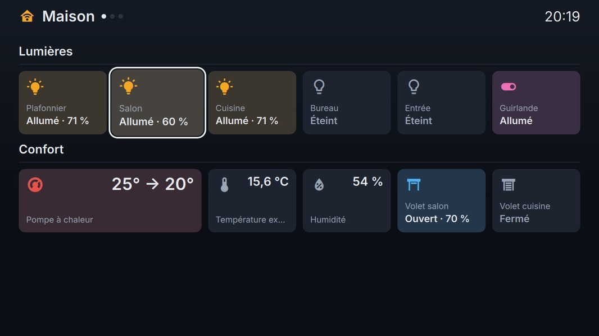
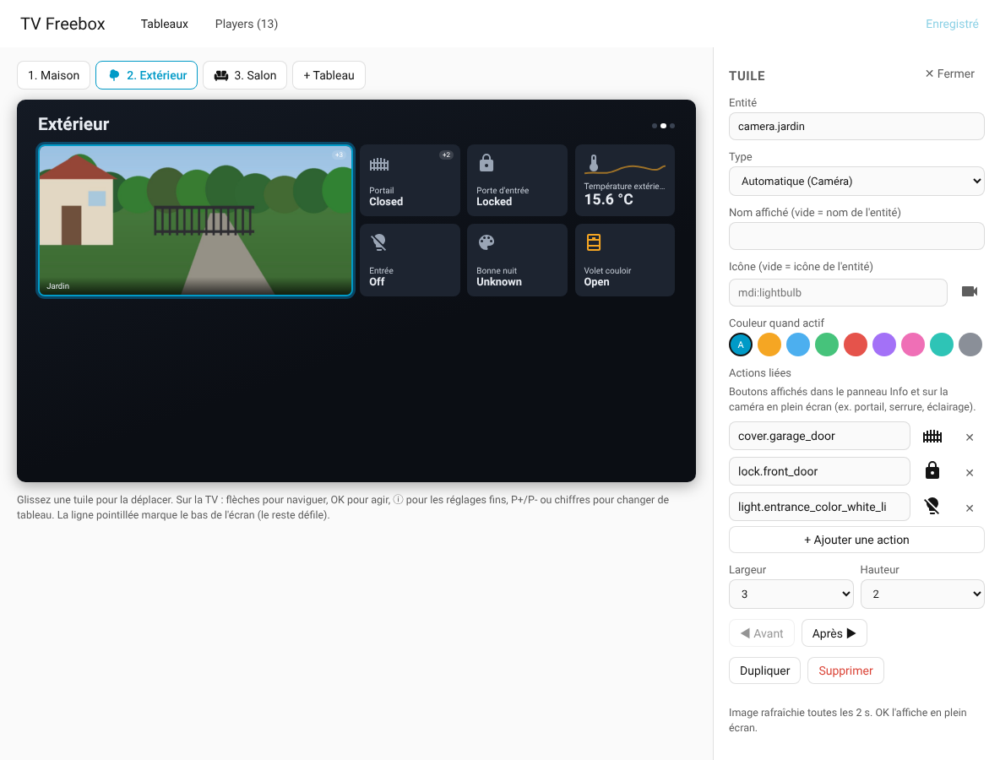
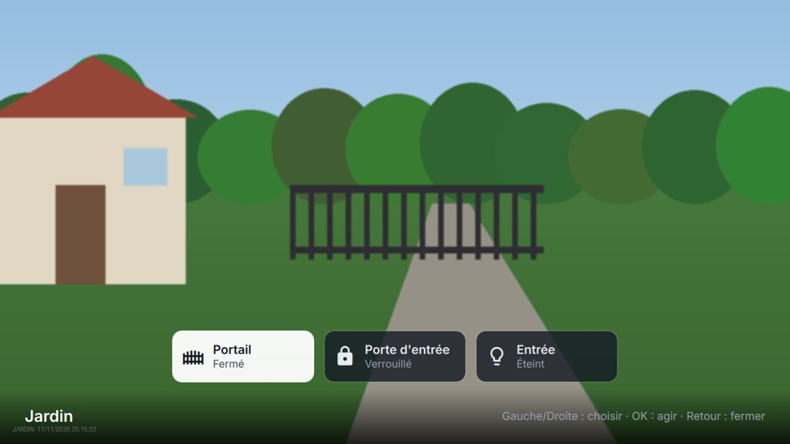

# Domus TV — Home Assistant dashboards on the Freebox Player

Design TV dashboards in Home Assistant with the mouse, then use them on the **Freebox Player** (Delta / Révolution) with the remote: lights, covers and gate, thermostats, locks, sensors with graphs, cameras with action buttons.

This repository holds both parts:

| Part | Folder | What it does |
|---|---|---|
| Home Assistant integration `domus_tv` | `custom_components/domus_tv` | Adds a **TV Freebox** page (editor + pairing), stores dashboards, serves them to the Player |
| Freebox app **Domus** | `tv/` | QML app for the Freebox Player (FreeStore: *Domus*) |

## Install the integration

### With HACS (recommended)

Or manually in HACS: **⋮ → Custom repositories** → `https://github.com/Namarusa/domus-tv`, type **Integration** → download **Domus TV** → restart Home Assistant.

### Manually

Copy `custom_components/domus_tv` into your `config/custom_components/` folder and restart Home Assistant.

### Then

**Settings → Devices & services → Add integration → Domus TV.** A **TV Freebox** entry appears in the sidebar (admins only).

## Design dashboards

- One tab per dashboard (they become pages on the TV), 3 to 8 columns, drag tiles to reorder.
- Per tile: entity, type, name, icon, colour, size, **graph** (sensors: 6 h → 7 days) and up to 4 **linked actions** (e.g. gate + front door on a camera tile).
- **Toute une pièce** adds every visible entity of an area in one click.
- Save: the TV updates within 2 seconds.

## Pair the Player

1. Open **Domus** on the Freebox Player and type the Home Assistant address with the remote.
2. The TV shows a 6-digit code: type it in **TV Freebox → Players**.

The Player receives a long-lived token for your user; revoke it from the same page at any time.

### Remote

| Key | Action |
|---|---|
| Arrows | move between tiles |
| OK | main action (toggle, run scene, open camera…) |
| Info | detail panel: brightness, setpoint, cover position, 24 h graph, linked actions |
| Menu | dashboards, reload, change address |
| P+ / P-, 1–9 | change dashboard |
| Back | close; twice to quit |

Locks always ask for a second OK.

## Network note

The Player must reach Home Assistant at a non-`10.0.0.x` address: the Player uses 10.0.0.x internally. If Home Assistant sits behind another router on 10.0.0.x, forward TCP 8123 from that router's Freebox-side address.

## API used by the Player

| Endpoint | Auth |
|---|---|
| `POST /api/domus_tv/pair/start`, `GET /api/domus_tv/pair/poll/{secret}` | none (pairing only) |
| `GET /api/domus_tv/layout`, `/states`, `/history` | Bearer |
| `POST /api/domus_tv/action` | Bearer — only entities placed on a dashboard |

---

Unofficial project, not affiliated with Home Assistant, the Open Home Foundation or Free. Icons: Material Design Icons (Apache 2.0).
